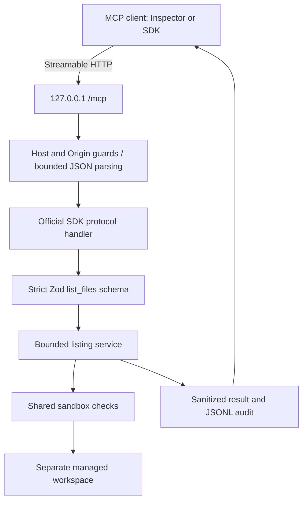

# M1 architecture

Startup validates the environment, canonicalizes the workspace, and rejects overlap with the source repository in either direction. The transport creates a fresh MCP server per request using the official SDK factory. The SDK owns protocol negotiation, discovery, serialization, and its stateless legacy fallback; our tool owns filesystem policy and useful results.

`list_files` validates its schema, resolves the requested directory, and walks only permitted entries. It uses `opendir` with a global scan budget rather than reading an unlimited directory into memory. Each encountered target is checked again through the sandbox. No file contents are read. Entries are sorted by name within each scanned directory. A result includes relative paths, metadata, continuation and budget flags. Expected failures return MCP `isError: true` with a safe error code/message.

Audit records go to stderr as JSONL. They contain UTC time, known tool name, success/error, elapsed time, return count or a safe error code. HTTP prevalidation also records schema-invalid `list_files` calls because the SDK rejects those before invoking the callback. Logging does not persist shared agent state.

The endpoint is stateless. M1 does not require sessions, resumable event streams, a database, or an orchestration layer. The SDK supports modern MCP requests and a 2025-era stateless compatibility path. Legacy GET and DELETE requests may return 405 because there is no session to resume or delete.

M1 only prepares placeholders for shared handoff files. It does not implement checkpoint generation or claim continuity between agents. Filesystem changes and handoffs will be added after the relevant milestones are approved.
